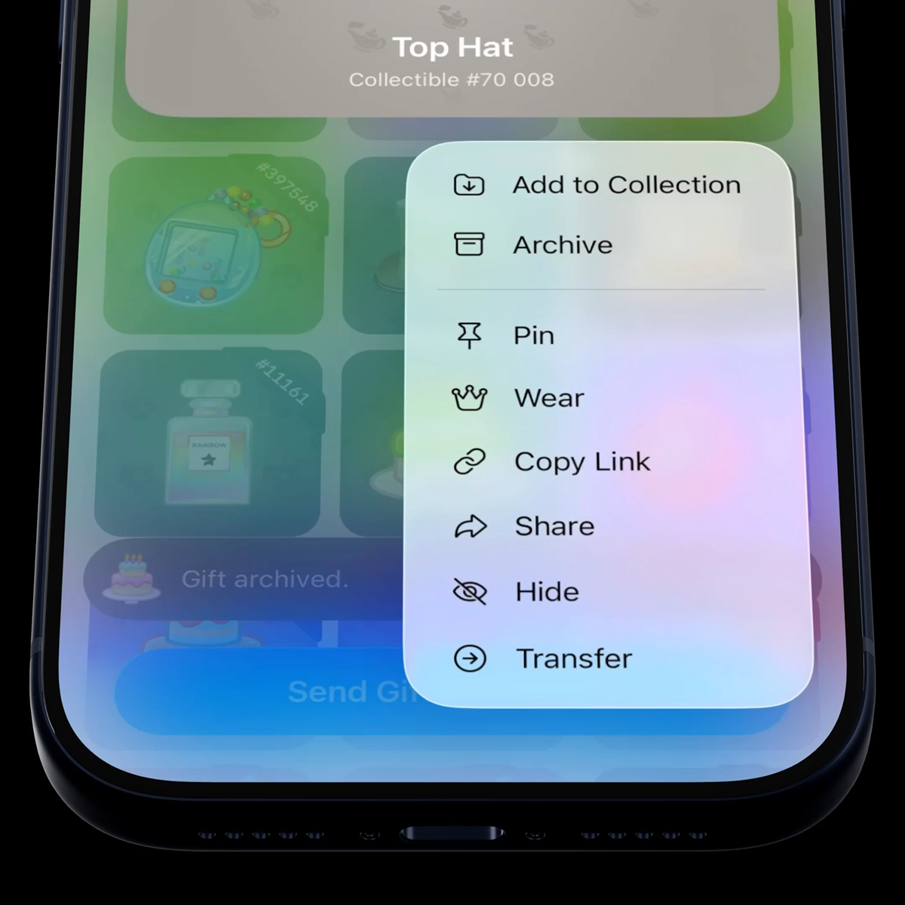

# Gift Archive for Telegram iOS

An Archive tab for the gifts in your profile. Long-press a gift, tap **Archive**, and it flies into its own tab: the grid stays tidy, pins and collections stay intact, and Undo or Unarchive brings it back.

[](Media/demo.mp4)

▶︎ [Media/demo.mp4](Media/demo.mp4) — the feature in the app (22 s).

## Why

Gift collections grow fast. Profiles collect dozens of gifts, and the grid shows them all at once: the ones you care about end up next to the ones you keep only because you got them. Collections help to group gifts, but they only add tabs on top of the full grid, which still lists everything.

Today the only way to get a gift out of the grid is to hide it from the profile or to give it away. The Archive is a third option: a place for the gifts you don't need at hand. They leave the main grid, keep their collections and pins, and come back with one tap.

## What it does

- **Archive from the gift's menu.** Long-press a gift in your own profile and tap **Archive**, right after *Add to Collection*. The gift's model leaves its cell and flies along a short arc into the **Archive** tab, shrinking to the size of the tab's icon; the tab bounces as the gift lands, and the rest of the grid closes the gap with a spring.
- **The Archive tab comes and goes by itself.** It appears with the first archived gift, after the collections and before *+ Add Collection*, and closes once the last gift has flown back. The tab row also appears for profiles without collections while the archive has something in it.
- **Undo and Unarchive.** Archiving shows a toast with the gift's sticker and **Undo**. In the Archive tab the menu offers **Unarchive** instead, and the gift flies back into *All*.
- **Your profile, your archive.** The Archive belongs to the profile's owner (or to a channel admin who manages its gifts). Visitors see the profile exactly as before.
- **An archive, not a collection.** In the Archive tab the **⋯** menu has no *Add Gifts* or *Reorder*, and archived gifts are unarchived before they can be added to a collection. The button at the bottom stays *Send a Gift*, as in *All*.
- **Toasts above the button.** Toasts in the gifts tab sit above the *Send a Gift* button instead of covering it.

## How it works

| Piece | Where |
| --- | --- |
| The archive store | `GiftsArchive.swift` (new) |
| Filtering the grid, the flight between a cell and a tab | `GiftsListView.swift` |
| The Archive tab, the menu items, the toasts | `PeerInfoGiftsPaneNode.swift` |
| Inserting and removing a tab with animation, the landing bounce | `TabSelectorComponent.swift` |

- **Storage.** In this concept the archive is kept on the device: one set of gift keys per account and profile in `UserDefaults`, keyed by `StarGiftReference`. No API changes are needed to try it. A production version would keep an *archived* flag on the saved gift on the server, the way *pinned* is kept, so it syncs across devices; only `GiftsArchive` would change, the UI stays as it is.
- **One list, two views.** *All* and *Archive* show the same gifts, filtered. Switching between them does not reload the list: a reload would drop every gift past the first page and bring them back page by page.
- **Reordering sees archived gifts too, on purpose.** The pinned order and a collection's order are read from that list when reordering ends; leaving archived gifts out would unpin them or drop them from their collections.
- **The flight.** When a gift's archive state changes, its cell fades out in place while the gift's model alone travels above the grid along a quadratic curve, timed with Telegram's spring. The model holds its current frame during the flight, so the animation doesn't restart. With no tab on screen there is no flight: the cell simply fades.
- **The tab row first.** Archiving updates the tab row before the grid, so the Archive tab already exists when the gift sets off towards it. When the last gift leaves the Archive, the tab waits 0.5 s for it to land in *All*, then closes.
- **`TabSelectorComponent`** (shared by nine screens) gets an opt-in `animateItemChanges` hint, off by default so the other screens are not affected, and `animateItemBounce(_:)`. It also stops the selection from flying in from the corner on the first layout.
- **Fewer relayouts.** `GiftsListView` now sends its status ("N gifts") only when it changes. The profile lays itself out again for every status it receives, and the repeated ones caused hitches during the animations.

## Repository

| Path | What |
| --- | --- |
| `changes.patch` | The whole feature as one patch for Telegram-iOS: 8 files, +535 −41 |
| `Sources/GiftsArchive.swift` | The new file from the patch, for reading |
| `Media/demo.mp4` | The recording of the feature |

## Changes

| File | Change |
| --- | --- |
| `submodules/TelegramUI/Components/PeerInfo/PeerInfoVisualMediaPaneNode/Sources/GiftsArchive.swift` | New: the archive store |
| `submodules/TelegramUI/Components/PeerInfo/PeerInfoVisualMediaPaneNode/Sources/GiftsListView.swift` | The archive filter, the flight to and from a tab, status sent only on change |
| `submodules/TelegramUI/Components/PeerInfo/PeerInfoVisualMediaPaneNode/Sources/PeerInfoGiftsPaneNode.swift` | The Archive tab, *Archive* / *Unarchive* in the gift's menu, toasts with Undo, toasts above the bottom button |
| `submodules/TelegramUI/Components/PeerInfo/PeerInfoScreen/Sources/PeerInfoScreenDisplayGiftsContextMenu.swift` | No *Add Gifts* or *Reorder* in the **⋯** menu of the Archive tab |
| `submodules/TelegramUI/Components/PeerInfo/CollectionTabItemComponent/Sources/CollectionTabItemComponent.swift` | An `.archive` icon for a tab |
| `submodules/TelegramUI/Components/Gifts/GiftItemComponent/Sources/GiftItemComponent.swift` | Exposes the gift's sticker layer for the flight |
| `submodules/TelegramUI/Components/TabSelectorComponent/Sources/TabSelectorComponent.swift` | Opt-in animated insertion and removal of tabs, the landing bounce, no selection flying in on the first layout |
| `Telegram/Telegram-iOS/en.lproj/Localizable.strings` | 5 new strings. Other languages show the English text until they are translated |

## Trying it

This is a change to the Telegram-iOS source tree, not a standalone app. Apply the patch to a checkout of [TelegramMessenger/Telegram-iOS](https://github.com/TelegramMessenger/Telegram-iOS) (made against `master` at `f1dd7a2`, October 7, 2026) and build the app as usual:

```sh
git apply changes.patch
```

Open your own profile, go to the **Gifts** tab, long-press a gift and tap **Archive**.

## Limitations

- **The archive is local.** It lives on this device only: other devices and a reinstall start with an empty archive, and visitors always see every gift. See *Storage* above for the server-side version.
- **The gift counter in the profile header still counts archived gifts.**
- **Archived gifts still appear** when picking gifts for a collection and among the pinned gifts around the avatar.

## License

Telegram-iOS is distributed under the GNU General Public License v2.0, and so is this patch. See [LICENSE](LICENSE).
